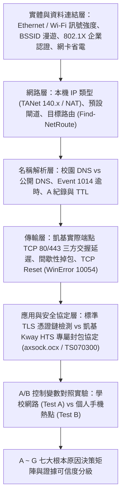

# 診斷方法論與科學取證設計 (`docs/methodology.md`)

## 1. 核心設計原則

本專案「壓力測試（Campus Network Diagnostic）」雖沿用資料夾名稱，但本質為一套**低負載、唯讀、非侵入式的端點連線診斷與證據蒐集系統**，專門解決凱基證券「新超級大三元」於台灣大學校園網路環境頻繁斷線或重新連線之問題。

設計嚴格遵循四大工程原則：

1. **零侵入與安全合規：** 絕不掃描校園網段、不執行大規模 Port Scan、不發送洪泛流量、不修改系統防火牆/DNS/Proxy/路由、不讀取或解密任何金融帳號/憑證/Session/委託紀錄。
2. **實證優先，拒絕臆測：** 所有測試目標均來自明確白名單或本機已安裝「新超級大三元」之官方靜態設定檔（`tab/YELLOWPAGE.INI`、`tab/LINK.INI`）及即時程序 Socket 狀態，絕不憑空假設伺服器 IP 或通訊埠。
3. **嚴謹證據分級：**
   - 不將 ICMP Ping 失敗等同服務不可用。
   - 不將 HTTP 403、TLS 交握失敗或單純逾時直接判定為「學校封鎖」。
   - 不將「未啟動的應用程式」判定為遭到網路限制。
   - 即使「手機熱點穩定、學校網路斷線」，亦先科學判定為「問題與學校網路環境（路徑/狀態設備/協定政策/Wi-Fi）有關」，須搭配協定行為、TCP Reset 或網管政策佐證，方能區分「NGFW 協定檢測/NAT 閒置逾時」與「刻意政策封鎖」。
4. **個人資訊最小化與自動遮罩：** 對本機使用者名稱、電腦主機名稱、MAC/BSSID、內網/校園端客戶端 IP 自動進行遮罩處理，且所有報告（含 HTML）均完全離線產生，不上傳任何外部伺服器。

---

## 2. 分層診斷架構（OSI / TCP-IP 由下而上）

---

## 3. 為何證券軟體在大學校園網路特別容易斷線？（技術機轉分析）

經本專案對凱基「新超級大三元」（Kway HTS 平台，`SUPERTSC64.exe` -> `axis.exe`）之實地剖析：

1. **Port 443/80 上的非標準 HTTP/TLS 專屬長連線協定：**
   - `tab/YELLOWPAGE.INI` 設定連線至 `gtstrade.kgieworld.com.tw`（國內交易）、`gtsquot.kgieworld.com.tw`（國內行情）等端點之 TCP `80` 與 `443` 埠。
   - 為穿透一般企業防火牆，軟體借用 Port 80/443，但底層跑的是 `axsock.ocx` 與 `TS070300` 專屬加密長連線，**並非標準 HTTP 或標準 TLS (HTTPS)**。
   - 大學校園出口普遍部署次世代防火牆（NGFW，如 Palo Alto Networks App-ID、Fortinet FortiGate Application Control）。當 NGFW 發現 Port 443 流量沒有標準 TLS `ClientHello` 時，常將其歸類為 `unknown-tcp` 或協定異常，進而套用極短的狀態逾時（例如 30～120 秒無雙向封包即回收 Session）或在深度檢測（DPI）後發送 TCP RST。
2. **校園 NAT 連線追蹤表（Conntrack）閒置回收：**
   - 大型校園網路多數宿舍或無線網路位於大型 NAT 設備後方，當尖峰時段連線數龐大時，NAT 設備會縮短 TCP Idle Timeout；若行情離峰或交易連線無頻繁 Keep-Alive，連線即被單向清除。
3. **校園多基地台 Wi-Fi 漫遊與 802.1X 重驗證：**
   - 校園無線網路密集部署多顆 AP，當訊號介於臨界值時網卡在同 SSID 不同 BSSID 間切換，或定期執行 WPA2-Enterprise (802.1X) 金鑰重換，會造成 0.5～3 秒瞬斷，足以使即時證券 Socket 觸發斷線重連。
4. **本機與帳號端因素：**
   - Windows 網卡「允許電腦關閉這個裝置以節省電源」、Modern Standby 待命、本機 VPN/代理殘留，或手機「隨身 e 策略」與電腦版同身分證字號重複登入互踢。

---

## 4. A/B 對照實驗控制變數規範

| 控制項目 | 測試 A（學校網路） | 測試 B（個人手機熱點） |
| --- | --- | --- |
| 測試電腦 | 同一台 Windows 電腦 | 同一台 Windows 電腦 |
| 軟體版本與設定 | 同一套新超級大三元（不更動設定） | 同一套新超級大三元（不更動設定） |
| 手機看盤 App | 關閉背景登入（排除同帳號互踢） | 關閉背景登入（排除同帳號互踢） |
| 監控取樣週期 | 每 30 秒低負載觀測 1 次 | 每 30 秒低負載觀測 1 次 |
| 建議持續時間 | 20 ～ 30 分鐘（相近時段） | 20 ～ 30 分鐘（相近時段） |
| 禁止行為 | 禁止自動登入、重複登入或送出委託 | 禁止自動登入、重複登入或送出委託 |

